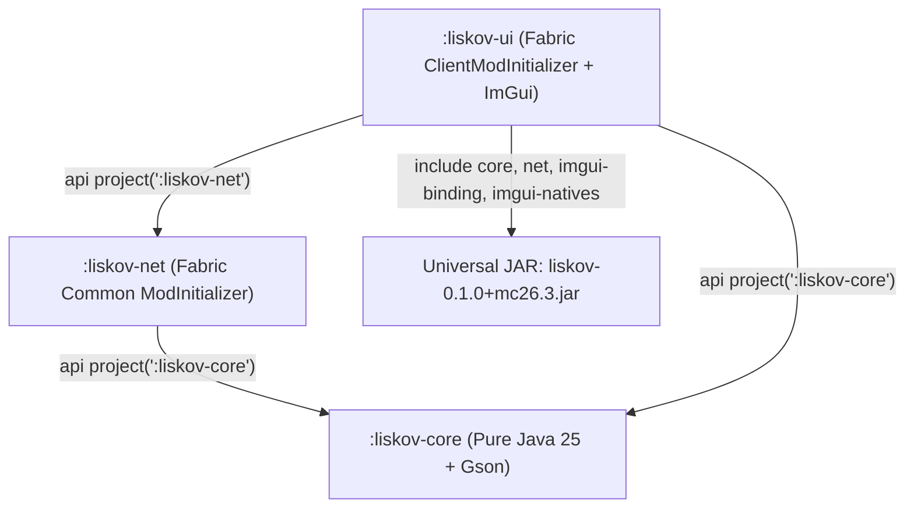
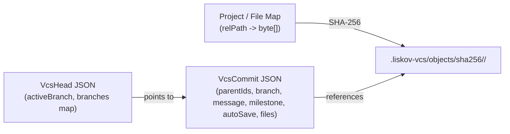
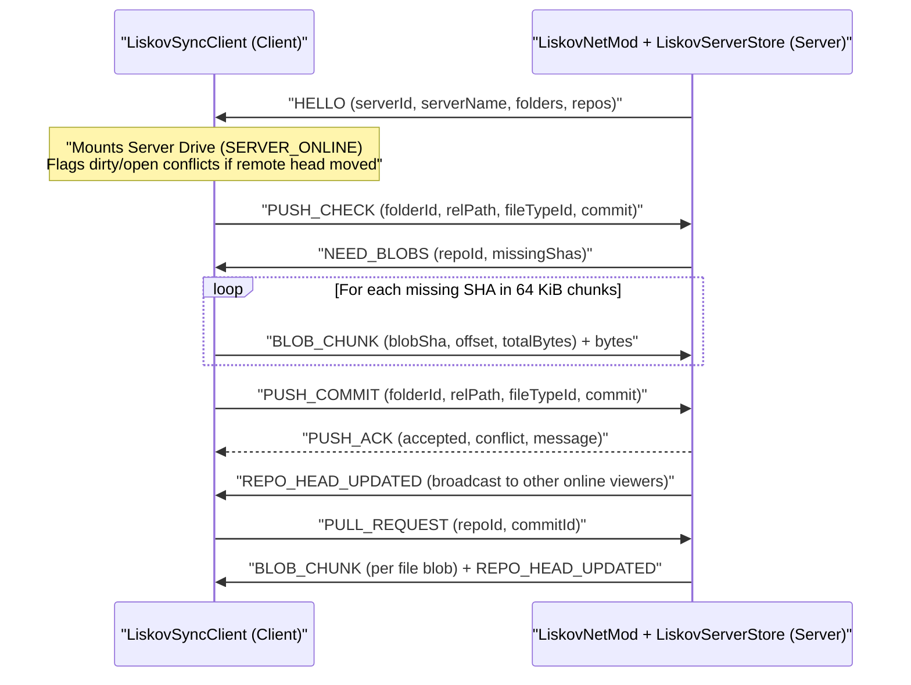
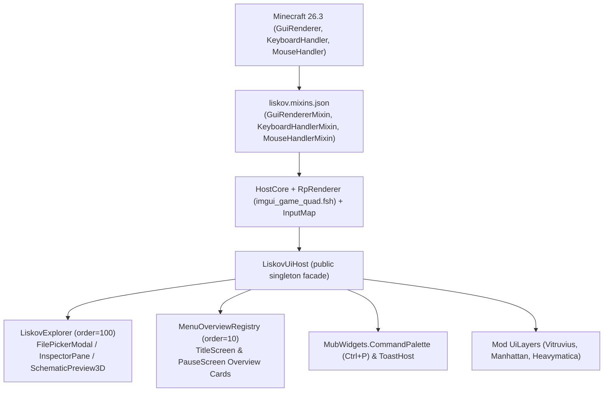

# Liskov System Architecture

Liskov (`0.1.0+mc26.3`, group `dev.liskov`) is a three-module Gradle build targeting Minecraft `26.3`, Fabric Loader `0.20.1+`, Fabric API `0.166.2+26.3`, Java `25`, and Dear ImGui `1.90.0`.

---

## 1. Three-Module Split & Packaging



### Module Responsibilities

| Module | Artifact ID | Dependencies | Role |
| --- | --- | --- | --- |
| `:liskov-core` | `liskov-core` | `com.google.code.gson:gson:2.11.0`, `org.junit.jupiter` (test) | Pure Java library (zero Minecraft/Fabric/ImGui imports). Owns `LiskovFs`, `LiskovDrives`, `DriveMount`, `LiskovMigration`, `FolderCatalog`, `FavoritesStore`, `TrashManager`, `ReloadWatcher`, `FileTypeRegistry`, `LitematicReader`, `.liskov-vcs/` (`VcsStore`), ACL/locks (`AclConfig`, `AccessEvaluator`, `LockGuard`), and sync wire models (`SyncWire`, `LiskovServerStore`). |
| `:liskov-net` | `liskov-net` | `:liskov-core`, `fabric-loader`, `fabric-api` | Common Client+Server Fabric entrypoint (`dev.liskov.net.LiskovNetMod`). Registers `liskov:sync` custom payload (`LiskovPayload`), manages server-world `LiskovServerStore`, handles client sync (`LiskovSyncClient`), notifies mods via `LiskovReloadBus`, and registers `/liskov`. |
| `:liskov-ui` | `liskov-ui` | `:liskov-net`, `:liskov-core`, `io.github.spair:imgui-java-binding:1.90.0` (+ lwjgl3 & natives), `fabric-loader`, `fabric-api` | Client Fabric entrypoint (`dev.liskov.ui.LiskovClientMod`, archivesName `liskov`). Owns the shared ImGui RenderPearl host (`LiskovUiHost`, `HostCore`, `RpRenderer`, `InputMap`, `ImGuiNatives`), `MubTheme`, `MubWidgets`, `MenuOverviewRegistry`, `SchematicPreview3D`, and `LiskovExplorer` / `FilePickerModal`. |

### Jar-in-Jar Packaging

`:liskov-ui` sets `base { archivesName = 'liskov' }` in [liskov-ui/build.gradle](file:///f:/workflow/Liskov/liskov-ui/build.gradle) and embeds the following artifacts via Fabric Loom's `include` configuration:

- `project(':liskov-core')`
- `project(':liskov-net')`
- `com.google.code.gson:gson:2.11.0`
- `io.github.spair:imgui-java-binding:1.90.0`
- `io.github.spair:imgui-java-lwjgl3:1.90.0`
- `io.github.spair:imgui-java-natives-windows:1.90.0`
- `io.github.spair:imgui-java-natives-linux:1.90.0`
- `io.github.spair:imgui-java-natives-macos:1.90.0`

**Result:** Users drop a single universal JAR (`liskov-ui/build/libs/liskov-<version>.jar`) into `mods/` on both Fabric clients and dedicated servers. On a dedicated server, `fabric.mod.json` in `:liskov-ui` declares `LiskovNetMod` under `"main"` and `LiskovClientMod` under `"client"`, while `liskov.mixins.json` only registers `"client"` mixins (`GuiRendererMixin`, `KeyboardHandlerMixin`, `MouseHandlerMixin`, `LitematicaRedirectMixin`).

### Consuming Liskov from Downstream Mods

Every module configures `maven-publish` (`publishing.publications.mavenJava`).

1. **Local multi-repo development (`publishToMavenLocal`):**
   ```powershell
   # In f:\workflow\Liskov
   .\build.bat publishToMavenLocal
   ```
   Then in the downstream mod's `build.gradle`:
   ```groovy
   repositories {
       mavenLocal()
   }
   dependencies {
       modCompileOnly "dev.liskov:liskov:${liskov_version}"
       // Or depend explicitly on individual modules:
       // implementation "dev.liskov:liskov-core:${liskov_version}"
       // modImplementation "dev.liskov:liskov-net:${liskov_version}"
       // modImplementation "dev.liskov:liskov-ui:${liskov_version}"
   }
   ```
   Wait on Fabric Loom: if using Loom `modImplementation` with `liskov` from `mavenLocal`, remember `liskov-ui` publishes artifactId `liskov` (`archivesName = 'liskov'`). Declare `"liskov": ">=0.1.0"` in `depends` inside `fabric.mod.json` (and do **not** `include` Liskov's ImGui or Liskov JARs if Liskov is an external mod dependency, unless intentionally JiJ-bundling).
2. **Sibling `includeBuild` (optional composite build):** Add `includeBuild('../Liskov')` in `settings.gradle` for live IDE co-editing without running `publishToMavenLocal` on every change, pairing dependency substitution for `dev.liskov:liskov-core`, `dev.liskov:liskov-net`, and `dev.liskov:liskov`.
3. **CI / GitHub Release artifacts:** Attach `liskov-<version>.jar` for end users and optionally publish module JARs to a Maven repository.

---

## 2. Drives Filesystem, Namespaces & Migration

`LiskovFs` is initialized once at client startup in `LiskovClientMod.onInitializeClient()` via `LiskovFs.init(gameDir, gameDir.resolve("config"))`.

### On-Disk Layout

```text
<gameDir>/
├── liskov/
│   ├── .migrated                         # LiskovMigration.Receipt (JSON; prevents re-running)
│   ├── liskov.json                       # MubTheme.UiConfig (themePreset, uiScale, titleOverviewOpen, pauseOverviewOpen, defaultViewMode)
│   ├── favorites.json                    # FavoritesStore (favorites + up to 20 recent entries)
│   ├── local/                            # DriveMount.Kind.LOCAL ("local" -> "Local")
│   │   ├── schematics/                   # LiskovNamespace("schematics", badge="Lm")
│   │   │   └── _folders.json             # FolderCatalog
│   │   ├── manhattan/                    # LiskovNamespace("manhattan", badge="Mp")
│   │   │   ├── config/manhattan.json
│   │   │   ├── projects/                 # *.mproj
│   │   │   ├── scripts/                  # *.mscript
│   │   │   └── captures/                 # *.mcap
│   │   ├── vitruvius/                    # LiskovNamespace("vitruvius", badge="Vp")
│   │   │   └── config/
│   │   └── heavymatica/                  # LiskovNamespace("heavymatica", badge="Hm")
│   │       └── config/
│   ├── servers/
│   │   └── <serverId>/                   # Persistent server UUID (DriveMount.SERVER_ONLINE / SERVER_OFFLINE)
│   │       ├── drive.json                # DriveMount.DriveMetadata (displayName, lastConnectedMs, cacheStates, pinnedOffline)
│   │       └── root/                     # Cached/pinned mirrors of remote shared files (<relPath>)
│   ├── .trash/                           # TrashManager (_manifest.json + moved items)
│   ├── .cache/
│   │   └── thumbs/
│   └── .liskov-vcs/                      # VcsStore (hidden from explorer file trees)
│       ├── objects/sha256/<ab>/<hash>    # Content-addressed immutable blobs
│       └── repos/<driveId>/<repoId>/     # head.json + commits/<commitId>.json
```

### Drives & Path Rules

- **Local Drive (`"local"`):** Always mounted, always writable (`DriveMount.Kind.LOCAL`), holds the registered namespaces (`schematics`, `manhattan`, `vitruvius`, `heavymatica`, plus any custom namespaces registered via `LiskovFs.registerNamespace(...)`).
- **Server Drives (`servers/<serverId>/`):** Keyed by a persistent server UUID generated in `<serverWorldRoot>/liskov/server.json` (`ServerIdentity`), so renaming a server or changing its IP/port preserves the same mount and cached files.
  - When connected, `LiskovDrives.mountServerOnline(serverId, displayName)` sets `Kind.SERVER_ONLINE` (`isWritable() == true`).
  - When disconnected, `LiskovDrives.markOffline(serverId)` keeps previously mounted drives visible as `Kind.SERVER_OFFLINE` (`isWritable() == false`).
- **Path Safety (`LiskovPaths`):**
  - `resolveInside(base, relative)` normalizes slashes and rejects `..` traversal or paths resolving outside `base`.
  - `safeName(raw)` strips/replaces invalid path characters (falling back to `"untitled"`).
  - `writeAtomicUtf8` / `writeAtomicBytes` write to a `.tmp` sibling and perform `Files.move(..., ATOMIC_MOVE, REPLACE_EXISTING)` (falling back to `REPLACE_EXISTING` on filesystems that disallow atomic move across handles).
- **Cross-Drive Transfer Semantics (`LiskovDrives.transfer`):**
  - Same-drive transfers (`srcDrive.driveId().equals(dstDrive.driveId())`): **MOVES** the item (`TransferKind.MOVED`) with `uniqueName` collision avoidance.
  - Any cross-drive transfer (`LOCAL <-> SERVER` or `SERVER A <-> SERVER B`): **COPIES** (`TransferKind.COPIED`) so the source copy stays intact and non-destructive.
- **Litematica Compatibility:** `LitematicaRedirectMixin` intercepts Litematica's `DataManager.getDefaultBaseSchematicDirectory()` and `getSchematicsBaseDirectory()` when `LiskovFs.isInitialized()`, redirecting Litematica seamlessly to `<gameDir>/liskov/local/schematics/`.

### Non-Destructive Legacy Migration (`LiskovMigration`)

`LiskovMigration.migrateLegacyOnce(LiskovFs)` runs on startup if `<gameDir>/liskov/.migrated` does not exist. It **never deletes or moves** legacy files—only copies missing targets via `LiskovPaths.copyMissingRecursive`:

| Legacy Source | Liskov Destination | Notes |
| --- | --- | --- |
| `<gameDir>/schematics/**` | `local/schematics/**` | `project.json` is renamed to `project.vproj` |
| `<legacyConfigDir>/manhattan.json` (or `baritonequeue.json`) | `local/manhattan/config/manhattan.json` | Prefers `manhattan.json` |
| `<legacyConfigDir>/manhattan-projects/**/*.json` | `local/manhattan/projects/**/*.mproj` | Skips `_*` files |
| `<gameDir>/scripts/**/*.txt` | `local/manhattan/scripts/**/*.mscript` | `.txt` -> `.mscript` |
| `<gameDir>/manhattan-context/**/*.txt` | `local/manhattan/captures/**/*.mcap` | `.txt` -> `.mcap` |
| `<legacyConfigDir>/vitruvius/**` | `local/vitruvius/config/**` | Preserves filenames |
| `<legacyConfigDir>/heavymatica/**` | `local/heavymatica/config/**` | Preserves filenames |

---

## 3. Hidden `.liskov-vcs/` Version Control & 3-Way Merge

`VcsStore` stores immutable history inside `<liskovRoot>/.liskov-vcs/` (client) and `<serverWorldRoot>/liskov/.liskov-vcs/` (server), completely separate from user-visible folders.



- **Repo Identity:** `VcsStore.repoIdFor(relPath)` hashes the normalized relative path (`SHA-256` hex), keeping `repos/<driveId>/<repoId>/` flat and immune to nested directory paths or special characters.
- **Snapshots & Bundles:** Each `VcsCommit` maps `Map<String, String> files` (`relPath -> blobSha256`), enabling multi-file atomic snapshots (e.g., `project.vproj` + `files/*.litematic`), explicit `milestone` pins (never pruned), and `autoSave` tags.
- **Branching & 3-Way Merge (`VcsStore.mergeBranch`):**
  - Finds Lowest Common Ancestor (LCA) via BFS over `parentIds`.
  - Handles `UP_TO_DATE`, `FAST_FORWARD`, `MERGED_CLEANLY`, and `MERGED_WITH_CONFLICTS` (creating a 2-parent merge commit and reporting `conflictedPaths` when `ours != theirs`, `ours != base`, `theirs != base`).
- **Restore & Pruning:** `restore(...)` writes a **new** forward commit copying the historical file map (history stays immutable); `prune(driveId, repoId, maxAgeDays, keepRecentCount)` respects `milestone` commits and active branch heads before `gcUnreferencedObjects()` sweeps orphan blobs.

---

## 4. Server Sync Protocol (`liskov:sync`), ACLs & `LockGuard`

### Server Store Layout

On any integrated or dedicated Fabric server running `:liskov-net`:

```text
<serverWorldRoot>/liskov/
├── server.json                 # ServerIdentity (persistent UUID serverId + displayName)
├── acl.json                    # AclConfig (per-folder AclGroup policies + named teams)
├── _folders.json               # FolderCatalog (shared server folders, default "shared")
└── .liskov-vcs/                # Authoritative server VcsStore
```

### Wire Framing & Sync Sequence

`LiskovPayload` registers Fabric payload ID `liskov:sync` carrying `(String json, byte[] data)` with a `512 KiB` JSON cap (`SyncWire.MAX_JSON_BYTES`) and `128 KiB` binary chunk cap (`SyncWire.MAX_CHUNK_BYTES`, default `SyncWire.CHUNK_SIZE = 65536`).



### ACLs & LockGuard

- **Roles (`AclRole`):** `NONE (0) < VIEW (1) < EDIT (2) < ADMIN (3)`.
- **Evaluation (`AccessEvaluator`):** Checks folder-level `AclGroup` (`defaultRole`, `playerRoles`, `teamRoles`, `teams` map) and returns the highest granted role. `canView`, `canEdit`, and `canAdmin` gate folder listing (`listVisibleFolders`), commits, downloads, and lock mutations.
- **Safety Guard (`LockGuard`):**
  - `LockState.lockedBy`: when locked, `canModify(actorUuid, isOp, lock)` blocks edits from everyone except the lock owner or server operators (`isOp`).
  - `canUnlock(actorUuid, isOp, confirmToken, lock)` allows the lock owner directly, or an OP only if `confirmToken` equals `LockGuard.OP_CONFIRM_TOKEN` (`"UNLOCK"`).
- **Live Reload Propagation (`LiskovReloadBus`):** When a remote `REPO_HEAD_UPDATED` or `PUSH_ACK` arrives (or a conflict occurs on an open/dirty repo), `LiskovSyncClient` updates the local mirror under `servers/<serverId>/<folderId>/` and fires `LiskovReloadBus.fireReload(...)` or `fireConflict(...)` for subscribing mods.

---

## 5. Shared UI Architecture (`:liskov-ui`)

`:liskov-ui` replaces per-mod Dear ImGui backends, fonts, shaders, and input mixins with a single coordinated host:



- **Rendering (`RpRenderer`):** Renders Dear ImGui draw lists using Minecraft 26.3's `GpuDevice` / `RenderPipeline` (`imgui_game_quad.fsh`) after `GuiRenderer.render(...)`. If any active `UiLayer` returns a non-null `float[4] dockedGameViewport()` (`{x, y, w, h}` in normalized UV or screen coordinates—`RpRenderer` draws the game framebuffer into that sub-rect when active), the world renders docked alongside ImGui tool panels.
- **Themes & Fonts (`MubTheme`):** 4 presets (`SYNTH_TERMINAL`, `GRUVBOX_PIXEL`, `TOKYO_NIGHT`, `DRAFTING_PAPER`), semantic color tokens (`BG`, `PANEL`, `PANEL2`, `SURFACE`, `ACCENT`, `CTA_BG`, `OK`, `WARN`, `ERR`, `BOT`, `PLAYER`, `CF`, `META`, ...), semantic role mapping via `colorFor(SemanticColor)`, and scaled `ImFont` accessors (`ui()`, `small()`, `mono()`, `monoS()`, `uiBold()`, `numM()`, `numL()`).
- **Extension Points for Mods:**
  - `LiskovUiHost.register(UiLayer)` — register full ImGui windows/overlays ordered by `UiLayer.order()`.
  - `FileActionRegistry.registerAction(...)` / `registerStatusProvider(...)` — add mod-specific contextual buttons (e.g. "Open in Vitruvius", "Queue in Manhattan") and live status badges (`CompletionTag`) in `LiskovExplorer`.
  - `MenuOverviewRegistry.register(CardProvider)` — render compact summary cards on `TitleScreen` and `PauseScreen`.
  - `MubWidgets.CommandPalette.register(Entry)` — expose mod commands in the unified `Ctrl+P` palette.
  - `FilePickerModal.openPicker(Request, Consumer<Path>)` — shared file selector backed by Drives + 3D preview.
